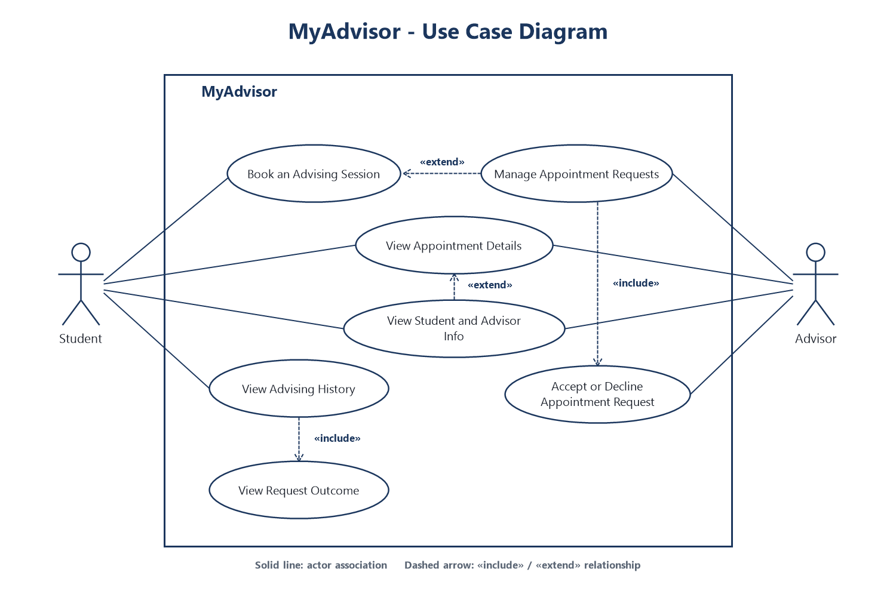
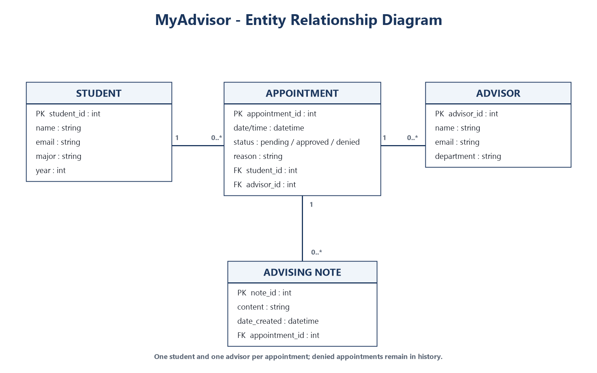
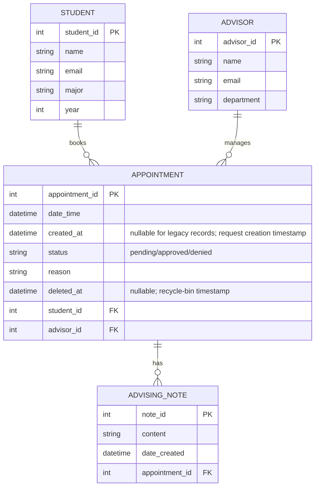
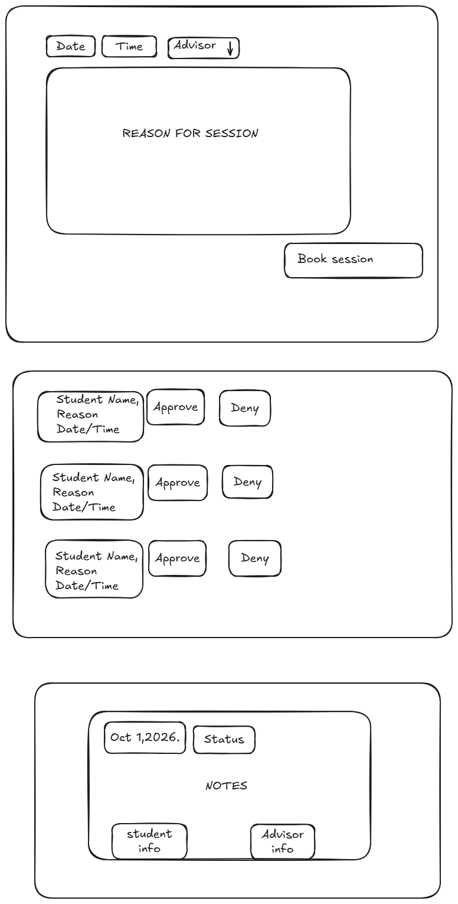

# COMP 3613 Assignment 1

Draft this file with the Guide. **Update it after every phase milestone** before you pause. The use-case diagram is a UML PNG at `docs/diagrams/use-case.png`, linked from this file as `diagrams/use-case.png` (path relative to `docs/report.md`). The model diagram is Mermaid. **Embed wireframe images** as `wireframes/<file>` (files live in `docs/wireframes/`).

Do not put your student ID in this file if you will commit it. The PDF cover adds your name and ID at export time.

## Assigned project

MyAdvisor — an app for students to track degree progress, plan semester course selections, and obtain approval from an administrator / advisor.

## Three workflows

### 1. Book an Advising Session (Student)

### 2. Manage Appointment Requests (Advisor)

### 3. View Advising History (Student)

## Use case diagram

[Open the use-case diagram](diagrams/use-case.png)

Phase 2 decisions: Managing appointment requests is a conditional extension of booking. Advisors can accept or decline requests, and students can see the outcome in their advising history. Students and Advisors both view appointment details. Viewing student and advisor information is an optional extension of viewing appointment details.

## Model diagram

Phase 3 model draft based on the student-defined entities and properties. Each appointment is assigned to exactly one student and one advisor when booked. Denied appointments remain visible in history. An appointment can have multiple advising notes, and every note belongs to exactly one appointment. For Phase 5, login accounts remain separate from Student/Advisor records; the signed-in account is matched to its profile by exact email.

The diagram image is shown above; the Mermaid source below is retained as the editable model.

## Wireframes

Combined student-created wireframe for the three named workflows:

<!-- student-build:wireframe-coverage
use_case: Book an Advising Session (Student)
image: docs/wireframes/wireframes.png
covered: yes
-->

<!-- student-build:wireframe-coverage
use_case: Manage Appointment Requests (Advisor)
image: docs/wireframes/wireframes.png
covered: yes
-->

<!-- student-build:wireframe-coverage
use_case: View Advising History (Student)
image: docs/wireframes/wireframes.png
covered: yes
-->

Coverage review: the booking screen now includes date, time, advisor selection, reason, and a booking action. Advisor request rows identify the student and show the date/time and reason alongside Approve/Deny actions. Student history displays appointment dates, statuses, and Student Info / Advisor Info controls. The student confirmed selecting an appointment from history or the request list opens appointment details with both the student's and advisor's profile information. The history controls suggest this path, but the advisor request sketch does not explicitly show how to open appointment details; consider adding a visible details action or indicating that selecting a request opens them.

`python manage.py report` also embeds any PNG/JPG still missing from `docs/wireframes/`.

## Theming

Brand: MyAdvisor, with a polished gold “JR” monogram and wordmark. The theme uses deep blue, gold, white, and black with Cormorant Garamond display type and Manrope body text. Applied to the public landing page, sign-in and registration screens, and authenticated navigation shell. Landing copy now describes the advising purpose rather than the starter placeholder.

## Implementation notes

Phase 5 theming is applied to the landing page, sign-in, registration, and authenticated navigation; the student reported the theme looks good. Login accounts remain separate from Student/Advisor records and are matched by exact email. The booking screen now lives on `/app` and follows the wireframe's date, time, advisor, reason, and Book Session controls. The thin POST route combines date and time, then delegates booking to the appointment service/repository; the service resolves the signed-in student's exact email, validates the selected advisor, and creates a pending appointment. The home route loads advisor options through those layers. `python manage.py init` / `seed` now idempotently add a local Bob student profile and sample advisor for development; `cmd_seed` also repairs demo account email/role values and relinks matching profiles without resetting passwords or dropping existing records. The current database was reseeded safely; verification confirmed Bob's `bob@example.com` account matches his Student profile and the advisor's `advisor@example.com` account matches the Advisor profile. The student ran the booking flow while signed in as Bob, reported that the request was submitted, and later confirmed seeing the revised pending-approval message.

Booking polish: the success message states that the request is pending advisor approval. On successful submission, booking redirects to the student Pending Requests page and highlights the new request.

The **View Advising History (Student)** workflow is implemented as a dedicated page. The repository fetches only resolved (approved or denied) appointments for the signed-in student's profile, newest first, with advisor records; the service resolves that profile by the account's exact email. The history page shows appointment date/time, reason, status, and expandable Student Info / Advisor Info. Pending requests have their own page and sidebar destination, including the post-booking redirect.

History date polish: each pending and resolved appointment displays its request-created weekday/date/time in a compact line. Student pending and resolved lists, plus Advisor History, are sorted by creation time descending, so newer requests appear first. Existing database rows receive a nullable `created_at` column through a non-destructive startup migration; older rows with no creation timestamp display “date unavailable” and sort after timestamped requests.

History polish: Approved cards and badges use green tints; Denied cards and badges use red tints; Pending cards remain blue in their separate student page. The student chose individual per-row deletion and later chose to add a recycle bin with restoration and permanent removal after 7 days. Appointment deletion now records an optional `deleted_at` timestamp, removes deleted records from active views, and exposes a student-scoped Recycle Bin in the authenticated sidebar. Restores are student-scoped; expired items are permanently purged when the student opens the bin or attempts restoration. Startup adds the nullable column to an existing SQLite/Postgres appointment table without resetting its data. The authenticated sidebar is fixed to the viewport and independently scrollable; a simple MyAdvisor copyright footer sits at the bottom of the content area. The student confirmed the delete, recycle-bin/restore, fixed-sidebar, and footer polish looks right in the browser.

The **Manage Appointment Requests (Advisor)** workflow uses the student's selected immediate row decision. The advisor is resolved by matching the signed-in email to an Advisor profile. Pending requests are listed with student, date/time, and reason. Approve/Deny submits a thin route to the service, which validates the decision and delegates a student/advisor-scoped pending-state update to the repository. Denying requires a non-empty explanation; the decision and AdvisingNote are saved together, and the note appears in both the student's Advising History and the advisor's history. After approval, the appointment leaves the advisor's pending list; the student can see its Approved status in Advising History. A separate Advisor History page lists that advisor's active approved and denied requests. The advisor account has no Student profile, so student booking/history/recycle-bin links are hidden for advisor users. A seeded advisor login (`advisor` / `advisorpass`) matches the sample Advisor profile for local testing. The student verified that a denial note saves and appears in both histories.

Authenticated header polish: the top navigation now uses the same navy token as the sidebar, touches the top and edges of the content area without increasing its height, and has a contrasting menu button. Appointment status styling differentiates Approved (green tint and badge) from Denied (red tint and badge); Pending remains blue. The student chose a separate Pending Requests area instead of including pending appointments in Advising History.

Role-based landing polish: after login, advisor accounts open Manage Requests rather than the student appointment booking page; the signed-in landing-page link also sends advisors to Manage Requests. Student and admin destinations remain unchanged.

The original `.venv` was Python 3.15 with Python 3.13 native extensions, which caused Pydantic and Argon2 import failures. A clean `.venv-py313` was created with the pinned requirements, `pip check` passes, and VS Code is configured to use that interpreter. The updated app is running at `http://127.0.0.1:5001`. The requested standalone `book_session.png` is not present; implementation follows the existing combined wireframe embedded above.

<!-- student-build:code-check
workflow: Book an Advising Session (Student)
form: choice
layer: other
architecture_ok: yes
implement_confidence: 0.78
passed: yes
note: Chose to place the booking form on the existing /app page and enable local testing with seeded demo profiles.
-->

<!-- student-build:code-check
workflow: Book an Advising Session (Student)
form: snippet
layer: model
architecture_ok: yes
implement_confidence: 0.78
passed: yes
note: Completed Student email as a unique, indexed SQLModel field matching the ERD.
-->

<!-- student-build:code-check
workflow: Book an Advising Session (Student)
form: snippet
layer: router
architecture_ok: yes
implement_confidence: 0.78
passed: yes
note: Route binds date, time, advisor, and reason; combines date/time and delegates booking via service/repository without persistence code.
-->

<!-- student-build:code-check
workflow: View Advising History (Student)
form: choice
layer: other
architecture_ok: yes
implement_confidence: 0.78
passed: yes
note: Chose a dedicated /appointments/history page.
-->

<!-- student-build:code-check
workflow: View Advising History (Student)
form: mcq
layer: service
architecture_ok: yes
implement_confidence: 0.78
passed: yes
note: Correctly placed coordinating the current student's profile-to-history lookup in the service.
-->

<!-- student-build:code-check
workflow: View Advising History (Student)
form: snippet
layer: model
architecture_ok: yes
implement_confidence: 0.78
passed: partial
note: Added Appointment-to-Student and Appointment-to-Advisor relationships; Guide removed unmatched back_populates references and organized model imports.
-->

<!-- student-build:code-check
workflow: View Advising History (Student)
form: snippet
layer: router
architecture_ok: yes
implement_confidence: 0.78
passed: yes
note: Added a thin GET handler calling AppointmentService and rendering the student history template without persistence logic.
-->

<!-- student-build:code-check
workflow: View Advising History (Student)
form: choice
layer: other
architecture_ok: yes
implement_confidence: 0.78
passed: yes
note: Requested a gold "New request" highlight, light-blue Pending badge, and red Approved/Denied badges.
-->

<!-- student-build:code-check
workflow: View Advising History (Student)
form: choice
layer: other
architecture_ok: yes
implement_confidence: 0.82
passed: yes
note: Chose confirmed per-appointment deletion; later expanded eligibility to pending, approved, and denied after learning bookings remain pending in the current app.
-->

<!-- student-build:code-check
workflow: View Advising History (Student) - recycle-bin polish
form: choice
layer: other
architecture_ok: yes
implement_confidence: 0.68
passed: yes
note: Chose restore from Recycle Bin and automatic permanent removal after 7 days.
-->

<!-- student-build:code-check
workflow: View Advising History (Student) - recycle-bin polish
form: snippet
layer: model
architecture_ok: yes
implement_confidence: 0.68
passed: partial
note: Added nullable deleted_at timestamp with default None after correcting the Optional annotation.
-->

<!-- student-build:code-check
workflow: View Advising History (Student) - recycle-bin polish
form: snippet
layer: router
architecture_ok: yes
implement_confidence: 0.68
passed: yes
note: Added thin student history trash route that delegates to service and renders the view without persistence code.
-->

<!-- student-build:code-check
workflow: View Advising History (Student) - recycle-bin polish
form: snippet
layer: repository
architecture_ok: yes
implement_confidence: 0.68
passed: yes
note: Queried deleted appointments scoped to student, joined Advisor details, and ordered by deletion time newest first.
-->

<!-- student-build:code-check
workflow: Manage Appointment Requests (Advisor)
form: choice
layer: other
architecture_ok: yes
implement_confidence: 0.61
passed: yes
note: Chose immediate approval or denial from each pending request row.
-->

<!-- student-build:code-check
workflow: Manage Appointment Requests (Advisor)
form: choice
layer: service
architecture_ok: yes
implement_confidence: 0.61
passed: yes
note: Chose matching the signed-in account email to an Advisor profile.
-->

<!-- student-build:code-check
workflow: Manage Appointment Requests (Advisor)
form: mcq
layer: service
architecture_ok: yes
implement_confidence: 0.61
passed: yes
note: Correctly identified service coordination for rejecting a decision on another advisor's request.
-->

<!-- student-build:code-check
workflow: Manage Appointment Requests (Advisor)
form: open
layer: router
architecture_ok: yes
implement_confidence: 0.61
passed: yes
note: Described binding path/form inputs, delegating identity and decision to service, flashing outcome, and redirecting without SQL/business logic in the route.
-->

<!-- student-build:code-check
workflow: Manage Appointment Requests (Advisor)
form: snippet
layer: model
architecture_ok: yes
implement_confidence: 0.61
passed: partial
note: Completed AdvisingNote fields from the ERD; corrected a timestamp field typo with Guide prompting.
-->

<!-- student-build:code-check
workflow: Manage Appointment Requests (Advisor)
form: snippet
layer: router
architecture_ok: yes
implement_confidence: 0.61
passed: partial
note: Wrote thin advisor decision route after describing its flow; Guide corrected the nested duplicate handler syntax and registered its error handling.
-->

<!-- student-build:code-check
workflow: Manage Appointment Requests (Advisor)
form: snippet
layer: repository
architecture_ok: yes
implement_confidence: 0.61
passed: partial
note: Implemented advisor- and pending-scoped status update; Guide requested corrections for return type, status variable, and excluding trashed requests before accepting.
-->

<!-- student-build:code-check
workflow: Manage Appointment Requests (Advisor)
form: snippet
layer: service
architecture_ok: yes
implement_confidence: 0.61
passed: yes
note: Resolved advisor by email, validated approve/deny, mapped to approved/denied, and delegated scoped update to repository.
-->

<!-- student-build:code-check
workflow: Manage Appointment Requests (Advisor) - resolved history polish
form: choice
layer: other
architecture_ok: yes
implement_confidence: 0.70
passed: yes
note: Chose a dedicated Advisor History page and sidebar link for resolved requests.
-->

<!-- student-build:code-check
workflow: Manage Appointment Requests (Advisor) - denial note polish
form: choice
layer: other
architecture_ok: yes
implement_confidence: 0.72
passed: yes
note: Chose to require an explanation when denying a request and show it in both student and advisor histories.
-->

<!-- student-build:code-check
workflow: View Advising History (Student) - pending separation polish
form: choice
layer: other
architecture_ok: yes
implement_confidence: 0.72
passed: yes
note: Chose a separate Pending Requests area on the student side, leaving Advising History for resolved appointments.
-->

One named workflow at a time. Include verify notes and polish / model revisions (Phase 5). Do not treat the first build as final.

## Deployed app

Phase 6. Public Render URL (not localhost). Markers open this to mark the three workflows.

https://

## Logins

Every account a marker needs, including extra users you added. Starter accounts:

- bob / bobpass — regular user
- admin / adminpass — admin
- advisor / advisorpass — advisor demo account

## YouTube URL

## Session transcripts

Filled when the Guide builds the report: the agent writes each Guide chat to `docs/transcripts/<slug>.md` (Copilot Agent, Cursor, or OpenCode). `python manage.py report` packages them. Do not paste chats here during the build.

## Competency (student-judge)

Filled when the report is built. Guide runs student-judge, writes `docs/judge.md`, and export appends the scorecard here.

## Skill integrity

Filled by `python manage.py report`. Do not edit the course skills.
